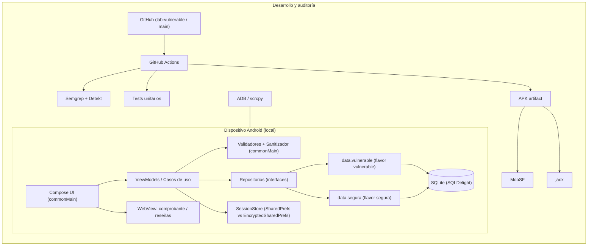
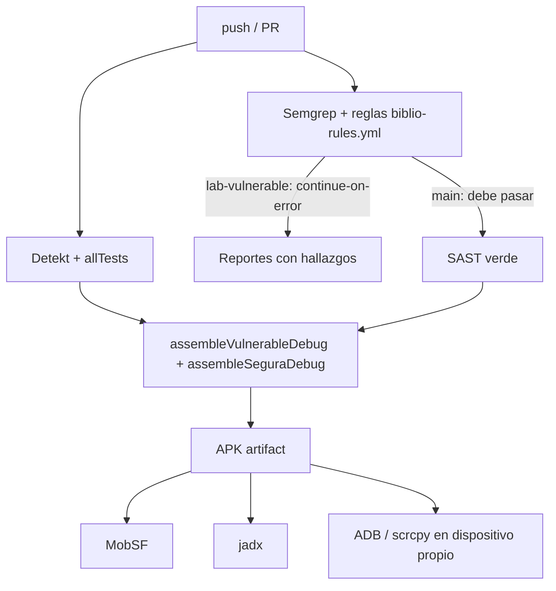

# Arquitectura de la Aplicación — BiblioSec

> **Propósito de este archivo:** responder *cómo está construida la aplicación* y cómo debe construirse.
> **Estado:** **arquitectura planificada, aún sin código** (verificado 24/11/2026; F0 pendiente). Los esqueletos y rutas provienen de `.docs/sistemaBiblioteca.md` (secciones 2, 3, 4, 8, 9, 10).
> **Reglas de trabajo:** ver [`../AGENTS.md`](../AGENTS.md) · **Requisitos:** ver [`Requisitos.md`](Requisitos.md).

---

## 1. Visión arquitectónica

Aplicación **Kotlin Multiplatform (KMP)** 100 % local: la UI y la lógica de negocio viven en `commonMain`, las capacidades de plataforma se declaran con `expect/actual` y se implementan en `androidMain` (y opcionalmente `desktopMain`). No hay backend: la persistencia es SQLite gestionada por SQLDelight dentro del dispositivo.

El elemento arquitectónico central es la **dualidad controlada**: el mismo código de UI y dominio se ejecuta contra dos implementaciones de repositorio intercambiables —una vulnerable y una segura— seleccionadas por un `ServiceLocator` según el flavor de build. Esto permite demostrar explotación y mitigación con la misma interfaz de usuario.

### Principios

- **Dependencias hacia adentro:** `ui → ViewModels/casos de uso → interfaces de repositorio → implementaciones → BD`.
- **Un solo punto de composición:** `ServiceLocator` elige la implementación; ninguna pantalla conoce el flavor.
- **Seguridad centralizada:** validación en `validation/`, sanitización y políticas en `security/`, nunca dispersa en la UI.
- **Aislamiento didáctico:** el código vulnerable existe solo para la demo y jamás se mezcla con el seguro.

---

## 2. Stack y capas

| Capa / Componente | Tecnología | Función |
| :--- | :--- | :--- |
| Lógica y UI compartida (`commonMain`) | Kotlin Multiplatform + Compose Multiplatform | Pantallas, estado (ViewModel/StateFlow), validadores, sanitizador HTML, reglas de negocio, interfaces de repositorio |
| Target móvil (`androidMain`) | Android SDK + `WebView` + `AndroidSqliteDriver` + `EncryptedSharedPreferences` | Compilación del APK, comprobante HTML, almacenamiento seguro de sesión (Keystore), hashing con `javax.crypto` |
| Target escritorio (`desktopMain`, opcional) | Compose Desktop (JVM) + `JdbcSqliteDriver` | Hot Reload e inspección directa del `.db` |
| Base de datos local | SQLite + SQLDelight | Usuarios, libros, préstamos, reseñas |
| Control de versiones y CI/CD | GitHub + GitHub Actions | Ramas `lab-vulnerable` / `main`, pruebas, SAST, build de APK |
| SAST | Semgrep + Detekt | Concatenación SQL, `WebView` inseguro, secretos, logs sensibles |
| DAST / binario | MobSF + ADB + `jadx` | Auditoría del APK, manifiesto, permisos, componentes exportados, extracción de datos, decompilación |
| Proyección en vivo | `scrcpy` | Duplicar la pantalla durante la defensa |

---

## 3. Diagrama de arquitectura (Mermaid)



---

## 4. Estructura de módulos y carpetas (planificada)

```
BiblioSec/
├── composeApp/
│   ├── build.gradle.kts
│   └── src/
│       ├── commonMain/kotlin/ec/edu/bibliosec/
│       │   ├── App.kt
│       │   ├── domain/            # Usuario, Libro, Prestamo, Resena, Rol, EstadoPrestamo
│       │   ├── validation/        # Validators.kt (allowlists, rangos, longitudes)
│       │   ├── security/          # HtmlSanitizer, PasswordHasher (expect),
│       │   │                      # SessionStore (expect), AccessPolicy, AppLogger
│       │   ├── data/
│       │   │   ├── repo/          # AuthRepository, LibroRepository,
│       │   │   │                  # PrestamoRepository, ResenaRepository
│       │   │   ├── vulnerable/    # Implementaciones inseguras (// VULN-n)
│       │   │   └── segura/        # Implementaciones seguras
│       │   ├── di/                # ServiceLocator según BuildConfig.SECURE_MODE
│       │   └── ui/
│       │       ├── login/ catalogo/ prestamo/ comprobante/ resenas/ admin/
│       │       └── theme/
│       ├── commonMain/sqldelight/ec/edu/bibliosec/db/Biblioteca.sq
│       ├── commonTest/kotlin/                 # Validators, sanitizer, hashing, policy, SQLi
│       ├── androidMain/
│       │   ├── AndroidManifest.xml
│       │   ├── res/xml/network_security_config.xml
│       │   └── kotlin/.../        # actual: PasswordHasher, SessionStore,
│       │                          # WebViewHtml, DriverFactory
│       ├── androidVulnerable/     # Manifest overlay inseguro (opcional)
│       ├── androidSegura/         # Manifest overlay seguro (opcional)
│       └── desktopMain/           # opcional
├── docs/                          # ENTREGABLES (versionado)
│   ├── ContextoProyecto.md
│   ├── Requisitos.md
│   ├── Arquitectura.md            # este archivo
│   ├── matriz-seguridad.md        # F4
│   ├── arquitectura.md            # diagrama para el informe (F9)
│   ├── informe-ieee/              # informe.tex / .docx + referencias
│   ├── reportes/                  # semgrep.sarif, detekt.html, mobsf.pdf
│   └── evidencias/VULN-01 … VULN-09/
├── .github/workflows/devsecops.yml
├── config/detekt/detekt.yml
├── .semgrep/biblio-rules.yml
├── gradle/libs.versions.toml
├── settings.gradle.kts
├── README.md
├── AGENTS.md
└── .docs/                         # especificación de entrada (IGNORADA por Git)
    ├── indicaciones.md
    └── sistemaBiblioteca.md
```

---

## 5. Regla de dependencias y puntos de composición

```
Compose UI (@Composable, @Preview)
        │  StateFlow / eventos
        ▼
ViewModels + Casos de uso  ────► Validators / AccessPolicy / HtmlSanitizer
        │
        ▼
Interfaces de repositorio (data/repo)
        │
        ├──► data.vulnerable  (flavor vulnerable)
        └──► data.segura      (flavor segura)
                    │
                    ▼
        SQLDelight → AndroidSqliteDriver / JdbcSqliteDriver → biblioteca.db
```

- **`ServiceLocator` (`di/`)** lee `BuildConfig.SECURE_MODE` (expuesto desde `commonMain` mediante `expect/actual`) y devuelve la implementación correspondiente. Es el único lugar que decide vulnerable vs. segura.
- **`expect/actual`:** `PasswordHasher`, `SessionStore`, `DriverFactory` y el render HTML del `WebView` se declaran en `commonMain` y se implementan en plataforma.
- **Prohibido:** que la UI importe directamente `data.vulnerable` o `data.segura`, o que los repositorios llamen a `Log.*`/`println` con datos sensibles.

---

## 6. Variantes de build (flavors)

Se usan **product flavors** en la dimensión `modo`, no build types, para poder tener distinto `applicationId`, distinto nombre de app **y** distinto `AndroidManifest` (overlay). Justificar esta decisión en el informe.

```kotlin
android {
    flavorDimensions += "modo"
    productFlavors {
        create("vulnerable") {
            dimension = "modo"
            applicationIdSuffix = ".vulnerable"
            versionNameSuffix = "-vuln"
            resValue("string", "app_name", "BiblioSec (VULN)")
            buildConfigField("boolean", "SECURE_MODE", "false")
        }
        create("segura") {
            dimension = "modo"
            applicationIdSuffix = ".segura"
            versionNameSuffix = "-seg"
            resValue("string", "app_name", "BiblioSec (SEGURA)")
            buildConfigField("boolean", "SECURE_MODE", "true")
        }
    }
    buildFeatures { buildConfig = true }
    buildTypes {
        getByName("debug") { }
        getByName("release") {
            isMinifyEnabled = true      // mitigación VULN-08
            isShrinkResources = true
            proguardFiles(getDefaultProguardFile("proguard-android-optimize.txt"), "proguard-rules.pro")
        }
    }
}
```

**Resultado:** variantes `vulnerableDebug`, `seguraDebug`, `vulnerableRelease`, `seguraRelease`. Ambas apps debug se instalan juntas:

```bash
./gradlew assembleVulnerableDebug assembleSeguraDebug
adb install -r composeApp/build/outputs/apk/vulnerable/debug/composeApp-vulnerable-debug.apk
adb install -r composeApp/build/outputs/apk/segura/debug/composeApp-segura-debug.apk
```

---

## 7. Modelo de datos (SQLDelight)

Archivo `commonMain/sqldelight/ec/edu/bibliosec/db/Biblioteca.sq`:

```sql
CREATE TABLE Usuario (
    id INTEGER PRIMARY KEY AUTOINCREMENT,
    username TEXT NOT NULL UNIQUE,
    password TEXT NOT NULL,          -- VULN: texto plano | SEGURA: hash "iter:salt:hash"
    rol TEXT NOT NULL CHECK (rol IN ('LECTOR','BIBLIOTECARIO')),
    codigoEstudiante TEXT,
    nombreCompleto TEXT NOT NULL
);

CREATE TABLE Libro (
    id INTEGER PRIMARY KEY AUTOINCREMENT,
    isbn TEXT NOT NULL UNIQUE,
    titulo TEXT NOT NULL,
    autor TEXT NOT NULL,
    categoria TEXT NOT NULL,
    copiasDisponibles INTEGER NOT NULL DEFAULT 1,
    restringido INTEGER NOT NULL DEFAULT 0   -- 1 = uso interno (solo bibliotecario)
);

CREATE TABLE Prestamo (
    id INTEGER PRIMARY KEY AUTOINCREMENT,
    libroId INTEGER NOT NULL REFERENCES Libro(id),
    usuarioId INTEGER NOT NULL REFERENCES Usuario(id),
    codigoEstudiante TEXT NOT NULL,
    dias INTEGER NOT NULL,
    observacion TEXT,
    estado TEXT NOT NULL DEFAULT 'PENDIENTE'
        CHECK (estado IN ('PENDIENTE','APROBADO','RECHAZADO','DEVUELTO')),
    fechaSolicitud TEXT NOT NULL,
    fechaDevolucion TEXT
);

CREATE TABLE Resena (
    id INTEGER PRIMARY KEY AUTOINCREMENT,
    libroId INTEGER NOT NULL REFERENCES Libro(id),
    usuarioId INTEGER NOT NULL REFERENCES Usuario(id),
    comentario TEXT NOT NULL,
    fecha TEXT NOT NULL
);
```

### Consultas seguras (parametrizadas)

```sql
loginSeguro:
SELECT * FROM Usuario WHERE username = ?;

buscarLibrosSeguro:
SELECT * FROM Libro
WHERE restringido = 0 AND (titulo LIKE '%' || :q || '%' OR autor LIKE '%' || :q || '%' OR isbn LIKE '%' || :q || '%');

insertarPrestamo:
INSERT INTO Prestamo(libroId, usuarioId, codigoEstudiante, dias, observacion, estado, fechaSolicitud)
VALUES (?, ?, ?, ?, ?, 'PENDIENTE', ?);

prestamosPendientes:
SELECT * FROM Prestamo WHERE estado = 'PENDIENTE';

actualizarEstadoPrestamo:
UPDATE Prestamo SET estado = ?, fechaDevolucion = ? WHERE id = ?;
```

> En la variante vulnerable, las consultas se construyen por concatenación (`'$user'`, `'$q'`) y viven marcadas con `// VULN-01` / `// VULN-02`. En la segura se usan las de arriba; el filtro por rol se aplica en el repositorio.

### Datos semilla

- Usuarios: `lector1 / lector123` (LECTOR, `E2024001`), `lector2 / lector456`, `biblio1 / admin123` (BIBLIOTECARIO).
- ≥12 libros, ≥3 con `restringido = 1` ("Manual interno de adquisiciones", "Archivo histórico reservado", "Tesis embargada").
- ≥2 préstamos y ≥2 reseñas. Contraseñas en texto plano (vulnerable) / hasheadas (segura).

---

## 8. Componentes de seguridad

| Componente | Ubicación | API / comportamiento | VULN |
| :--- | :--- | :--- | :--- |
| `Validators` | `commonMain/validation/Validators.kt` | `ValidationResult` sellado (`Ok` / `Error`); `dias` 1–15, `codigoEstudiante` `^E\d{7}$`, `observacion` ≤200 sin caracteres de control, `username` `^[a-zA-Z0-9_.]{3,30}$`, `busqueda` ≤60 | VULN-04 |
| `HtmlSanitizer` | `commonMain/security/HtmlSanitizer.kt` | `escape(input)`: `& → &amp;`, `< → &lt;`, `> → &gt;`, `\" → &quot;`, `' → &#39;` | VULN-03 |
| `AccessPolicy` | `commonMain/security/AccessPolicy.kt` | `Accion` enum (7 acciones); mapa `Rol → Set<Accion>`; `puede(rol, accion)` y `require(rol, accion)` que lanza `AccesoDenegadoException`. Lector: solo `BUSCAR`, `SOLICITAR_PRESTAMO`; Bibliotecario: todas | VULN-09 |
| `PasswordHasher` | `expect` en `commonMain`; `actual` en plataforma | `hash(password)` → `"iter:saltB64:hashB64"`; `verify(password, stored)`. PBKDF2WithHmacSHA256, 120 000 iteraciones, salt 16 B, `MessageDigest.isEqual` | VULN-05 |
| `SessionStore` | `expect` en `commonMain`; `actual` en plataforma | SharedPreferences estándar (vulnerable) vs. `EncryptedSharedPreferences` con MasterKey en Keystore (segura). Solo `userId`, `rol`, expiración | VULN-05, VULN-09 |
| `AppLogger` | `commonMain/security/` | Envoltura de logging sin datos sensibles; no-op en release. Prohíbe `Log.*`/`println` directos | VULN-07 |
| `comprobanteHtml` | `commonMain/security/` (o UI) | HTML con meta CSP `default-src 'none'; style-src 'unsafe-inline'` y todo dato pasado por `HtmlSanitizer.escape()` | VULN-03 |

### Esqueleto de referencia: política de acceso

```kotlin
enum class Accion { BUSCAR, SOLICITAR_PRESTAMO, VER_ADMIN, APROBAR_PRESTAMO,
                    REGISTRAR_LIBRO, MARCAR_DEVOLUCION, VER_RESTRINGIDOS }

object AccessPolicy {
    private val permisos = mapOf(
        Rol.LECTOR to setOf(Accion.BUSCAR, Accion.SOLICITAR_PRESTAMO),
        Rol.BIBLIOTECARIO to Accion.entries.toSet()
    )
    fun puede(rol: Rol, accion: Accion) = permisos[rol]?.contains(accion) == true
    fun require(rol: Rol, accion: Accion) {
        if (!puede(rol, accion)) throw AccesoDenegadoException(accion)
    }
}
```

> `AccessPolicy.require(...)` se invoca en **tres capas**: navegación, casos de uso y repositorio. El rol se obtiene de la BD mediante `userId`, nunca de preferencias editables.

### Manifiestos

```xml
<!-- SEGURA -->
<application
    android:allowBackup="false"
    android:usesCleartextTraffic="false"
    android:networkSecurityConfig="@xml/network_security_config"
    android:dataExtractionRules="@xml/data_extraction_rules"
    android:debuggable="false" />  <!-- solo release -->

<!-- VULNERABLE (overlay en src/androidVulnerable) -->
<application android:allowBackup="true" android:usesCleartextTraffic="true"
    tools:replace="android:allowBackup,android:usesCleartextTraffic" />
```

Componentes: `exported="false"` salvo `MainActivity` con `LAUNCHER`.

---

## 9. UI y navegación

| Pantalla | Rol | Contenido clave | Protegida por |
| :--- | :--- | :--- | :--- |
| Login | Todos | Usuario, contraseña oculta, error genérico, indicador de variante | — |
| Catálogo | Lector / Biblio | Buscador, lista de libros, botón "Solicitar préstamo" | `BUSCAR` / `VER_RESTRINGIDOS` |
| Solicitud de préstamo | Lector | Libro, días, código, observación con contador, errores por campo | `SOLICITAR_PRESTAMO` |
| Comprobante digital | Lector | `WebView` con ticket HTML (libro, usuario, días, estado, observación) | Sesión activa |
| Detalle + reseñas | Lector | Datos del libro, tarjetas de reseña, formulario nueva reseña | Sesión activa |
| Mis préstamos | Lector | Lista con estado | Sesión activa |
| Panel del bibliotecario | Biblio | Pestañas *Pendientes*, *Libros* (checkbox "restringido"), *Devoluciones* | `VER_ADMIN` + cada acción |

Cada pantalla incluye `@Preview`. La ruta `admin` se protege en navegación **y** cada operación se verifica en caso de uso y repositorio.

### Flujos principales

1. **Login:** UI → `AuthRepository.login(user, pass)` → (segura) `loginSeguro` + `PasswordHasher.verify` → `SessionStore` → navegación por rol. (Vulnerable: SQL concatenado y sesión en prefs planas.)
2. **Búsqueda:** UI → validador → `LibroRepository.buscar(q, rol)` → query parametrizada/ concatenada → filtro de restringidos por rol → lista.
3. **Préstamo:** UI → `Validators` → `PrestamoRepository.solicitar(...)` → `insertarPrestamo` (estado `PENDIENTE`) → comprobante.
4. **Comprobante/reseñas:** datos escapados con `HtmlSanitizer` → HTML con CSP → `WebView` con JavaScript deshabilitado.
5. **Admin:** `AccessPolicy.require(...)` → aprobar/rechazar, alta de libros, devolución → `actualizarEstadoPrestamo`.

---

## 10. Estrategia de pruebas

| Suite | Ubicación | Objetivo |
| :--- | :--- | :--- |
| `ValidatorsTest` | `commonTest` | Tablas de casos válidos/inválidos (días, código, observación, búsqueda) |
| `HtmlSanitizerTest` | `commonTest` | `<script>`, ``, entidades, comillas, Unicode |
| `PasswordHasherTest` | `commonTest` | Salt aleatorio, formato, verify OK/KO |
| `AccessPolicyTest` | `commonTest` | Matriz `Rol × Accion` |
| `SqlInjectionTest` | `commonTest` (BD en memoria / JDBC desktop) | Payloads contra repositorios **seguros** |

Comando: `./gradlew allTests` (o `testDebugUnitTest`). Objetivo de cobertura: **≥80 %** en `validation/` y `security/`.

---

## 11. CI/CD y auditoría



- **SAST:** `--config p/kotlin --config p/android --config .semgrep/biblio-rules.yml --sarif --output semgrep.sarif --error composeApp/src`.
- **Reglas personalizadas:** `kotlin-sql-concatenation`, `android-webview-js-enabled`, `kotlin-log-sensitive`.
- **Ramas:** `lab-vulnerable` conserva reportes en rojo; `main` pasa en verde (SAST sobre source sets seguros, con exclusión documentada de `**/vulnerable/**`).
- **DAST/binario:** MobSF (Docker, puerto 8000) y `jadx`, con exportación a `docs/reportes/` y evidencias.

---

## 12. Decisiones arquitectónicas (ADR resumidas)

| ID | Decisión | Justificación |
| :--- | :--- | :--- |
| ADR-01 | KMP + Compose, **sin backend** | Laboratorio 100 % local, sin servidores de terceros ni Android Studio; permite ejecutar en emulador/dispositivo propio |
| ADR-02 | **Product flavors** en dimensión `modo` en vez de build types | Dos apps con distinto `applicationId` que conviven y permiten además distinto `AndroidManifest` (cleartext, backup) |
| ADR-03 | Repositorios + `ServiceLocator` | Misma UI para vulnerable y segura; el flavor solo cambia la implementación inyectada |
| ADR-04 | PBKDF2WithHmacSHA256 + salt en vez de BCrypt | Equivalente o superior y **sin librerías externas**; compatible con `javax.crypto` |
| ADR-05 | Sanitización + CSP + JS deshabilitado | Defensa en profundidad frente a XSS en `WebView` |
| ADR-06 | `AccessPolicy` en navegación + casos de uso + repositorio | Evita que ocultar un menú se confunda con control de acceso (VULN-09) |
| ADR-07 | `expect/actual` para hashing, sesión y driver | Lógica compartida en `commonMain`, primitivas criptográficas y SQLite en plataforma |
| ADR-08 | `.docs/` (ignorado) vs. `docs/` (versionado) | Separar la especificación de entrada de los entregables evaluables |
| ADR-09 | R8/ProGuard solo en release | Ofuscación como mitigación VULN-08 sin estorbar el debug de la demo |

---

## 13. Estado de implementación

| Elemento | Estado |
| :--- | :--- |
| `settings.gradle.kts`, `gradle/libs.versions.toml`, `composeApp/` | ❌ No existe (F0) |
| Código Kotlin (`App.kt`, dominio, repositorios, UI) | ❌ No existe (F1/F2/F3/F5) |
| `Biblioteca.sq` y seed | ❌ No existe (F1) |
| Tests `commonTest` | ❌ No existe (F6) |
| `.github/workflows/devsecops.yml`, `.semgrep/`, `config/detekt/` | ❌ No existe (F7) |
| Documentación de onboarding (`AGENTS.md`, `docs/*.md`) | ✅ Creada |

**Siguiente paso:** F0. Setup — crear el proyecto KMP, declarar dependencias en `libs.versions.toml`, configurar flavors y verificar `./gradlew assembleVulnerableDebug assembleSeguraDebug`.
